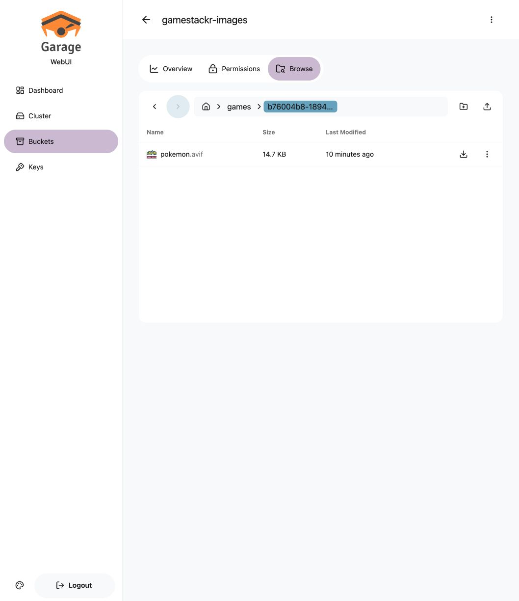

# Validation du stockage d’images local — 15 novembre 2026

> Archive historique. La commande de copie vers S3 et la conversion des images existantes ont été retirées.
> Voir [les instructions de stockage actuelles](../../README.md#stockage-s3-local-et-interface).

Branche `codex/local-image-storage`, Garage 2.4.0 et Garage Web UI 1.1.0,
Docker Desktop sur macOS ARM64. Les deux images Docker ont été vérifiées pour
ARM64 et AMD64. Cette validation concerne l’environnement de développement.

## Résultats

- Suite PHP : **192 tests, 1 205 assertions**. Elle utilisait auparavant
  180 tests et 1 136 assertions ; tous les tests existants restent verts.
- Pint : 100 fichiers conformes. PHPStan : aucune erreur.
- Frontend : formatage de 114 fichiers, lint de 69 fichiers et TypeScript
  sans erreur après génération des routes Wayfinder.
- Intégration Garage explicite : **2 tests, 18 assertions**. Écriture, lecture,
  liste, MIME AVIF, lecture HTTP publique, CORS, renommage, remplacement,
  suppression, rollback SQL et conversion d’un ancien WebP sur S3 validés.
- Configuration : génération privée, relance sans rotation des secrets,
  paramètres externes préservés et absence de secrets dans les sorties testés.
- Migration : simulation puis copie de **13 images existantes**, y compris le
  jeu masqué ; chaque copie relue et vérifiée par SHA-256. Sources locales
  conservées. Les écritures ont été suspendues avant copie et bascule.
- Environnement local activé avec `GAME_IMAGES_DISK=s3`, cache vidé et services
  applicatifs redémarrés. Les **12 jeux publics** chargent leur image depuis
  `gamestackr-images.localhost:3902` dans le navigateur.
- Redémarrage complet `make down` puis `make up` : tous les services sains,
  empreintes des **13 images**, de l’état et des accès S3 strictement identiques.

## Parcours navigateur

La Web UI exige une connexion. Après authentification, le bucket
`gamestackr-images` et ses objets sont visibles. La navigation dans `games/`
fonctionne ; la miniature de `pokemon.avif` est affichée par l’interface native.
Aucune galerie spécifique n’a été ajoutée.



Depuis une session administrateur déjà connectée, un jeu temporaire a été
créé dans Filament avec un PNG de test. L’envoi s’est terminé, la sauvegarde a
ouvert le formulaire d’édition et la page publique a chargé l’AVIF depuis
Garage. Le jeu et son objet S3 ont ensuite été supprimés ; le catalogue retrouve
ses 13 jeux initiaux. Aucun compte administrateur n’a été ajouté pour cet essai.

## Commandes reproductibles

```sh
make check
docker compose exec -T app php artisan test tests/Integration/GarageStorageTest.php
make storage-init
make down
make up
```

Les tests habituels utilisent des disques simulés. Le test d’intégration est
volontairement explicite et utilise la base dédiée `gamestackr_testing` avec des
objets UUID nettoyés en fin de test. Les identifiants, mots de passe et données
Garage ne sont pas versionnés.

## Limites et choix

- Le checkout existant est conservé sur une nouvelle branche : Docker et les
  données locales restent attachés au même projet. Un second checkout n’aurait
  pas isolé les volumes déjà utilisés.
- Les accès S3 générés fournissent les valeurs locales de repli ; des variables
  `AWS_*` non vides ont priorité. Un fournisseur externe exige une configuration
  complète et cohérente, sans mélanger les deux sources.
- La configuration Docker est locale, sans HTTPS ni réplication. Elle ne
  constitue pas une configuration de production.
- Les miniatures dépendent des formats pris en charge par le navigateur.
- Une action directe dans Garage ne synchronise pas la base des jeux. Les
  modifications métier continuent de passer par Filament.
- Revenir au disque `public` après de nouvelles écritures S3 nécessite d’abord
  de recopier les fichiers actuels. Les sources historiques seules ne couvrent
  pas les ajouts et remplacements effectués depuis la migration.

## Revue indépendante

La totalité des changements `aba0eea..ce439fc` a été relue dans un contexte
indépendant, avec la spécification, le plan et les règles de cycle de vie
existantes. Aucun défaut critique, important ou mineur à corriger n’a été
identifié. La revue est favorable dans le périmètre local approuvé.

Les limites laissées à cette étape ont été confirmées : production à préparer
séparément ; nettoyage d’objets orphelins potentiellement manuel après un arrêt
brutal ; écritures suspendues pendant la migration ; copie distincte nécessaire
pour changer de bucket ou de fournisseur ; miniatures natives dépendantes du
navigateur. Ces limites ne sont pas des mécanismes de récupération automatiques.

La branche est conservée pour l’utilisateur, sans fusion ni push.
